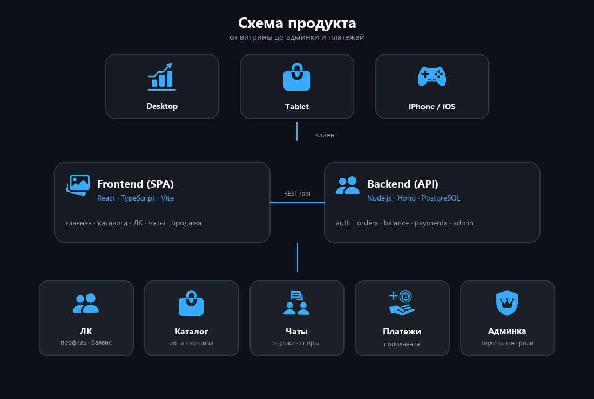
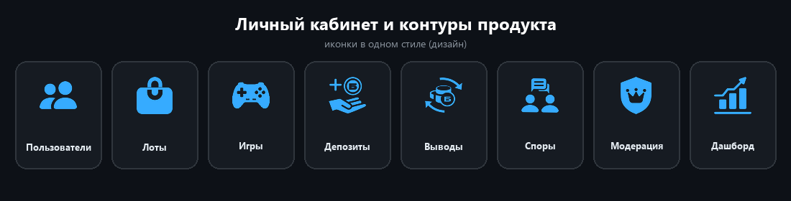

  

<h1 align="center">Безбаныч</h1>

Маркетплейс игровых товаров

  <strong>Фронт · бэк · каталоги · ЛК · платежи · админка</strong>

> [!IMPORTANT]
> **Коммерческий проект.** В репозитории — описание кейса, схема и демо. **Исходный код не публикуется.**

---

## Кратко

**Безбаныч** — маркетплейс игровых товаров. Долго делал: главная по Figma, дальше вся логика и внутренние страницы сам — каталоги, лоты, ЛК, сделки.

Сделано целиком по продукту: **фронтенд и бэкенд**.  
Готов к открытию: баги закрыты, защиты поправлены, адаптив под мобилку / планшет / iPhone.

Релиз в прод не состоялся — на стороне заказчика запуск остановили. Продукт сдан рабочим.

---

## Схема

  

| Контур | Что внутри |
|--------|------------|
| Клиент | Desktop / Tablet / iPhone |
| Frontend | React SPA: главная, каталоги, ЛК, чаты, продажа, админ‑UI |
| Backend | Hono API: auth, лоты, заказы, баланс, платежи, админка |
| Сервисы | ЛК, каталог, чаты, платежи, модерация |
| Инфра | PostgreSQL, Docker, Caddy, VPS |

---

## Личный кабинет и контуры

Иконки из одного дизайн‑ряда продукта:

  

---

## Что сделано

### Главная и каталоги
- Главная по Figma: вёрстка, анимации, баннеры, подборки
- Каталоги игр и разделов, карточки лотов, избранное, корзина
- Страницы продавца, отзывы, статьи, FAQ, юрдоки

### Пользовательский контур
- Вход и регистрация: email‑код + OAuth (VK / Яндекс / Mail / Telegram)
- Профиль, баланс, бонусы
- Продажа: черновики → модерация → публикация
- Чаты по сделкам, уведомления, push

### Платежи
- Пополнение баланса и результат оплаты
- Связка с платёжными провайдерами (в т.ч. Steam / Stars)
- Трекинг ссылок: клик → регистрация → депозит → покупка

### Админка
- Пользователи, продавцы, заявки, модерация, споры
- Баннеры и контент главной, промокоды, рассылки
- Роли и права, системные настройки

### Адаптив и сдача
- Мобильная / планшетная вёрстка, правки под iPhone / iOS
- Закрытие багов и hardening auth / сессий / админ‑зон
- Деплой на VPS, продукт готов к открытию

---

## Стек

| Слой | Технологии |
|------|------------|
| Frontend | React, TypeScript, Vite, React Router |
| Backend | Node.js, Hono, PostgreSQL |
| Auth | email‑коды, OAuth, cookie‑сессии |
| Платежи | внешние провайдеры |
| Прочее | web‑push, Telegram‑бот, Vitest |
| Инфра | Docker, Caddy, VPS |

---

## Демо

### Desktop

<video src="docs/demo-pc.mp4" controls width="800"></video>

[demo-pc.mp4](docs/demo-pc.mp4)

### Mobile / iPhone

<video src="docs/demo-mobile.mp4" controls width="320"></video>

[demo-mobile.mp4](docs/demo-mobile.mp4)

---

## Формат работы

Коммерческий заказ на длительный срок: Figma → фронт и бэк → каталоги и внутренние страницы → платежи и админка → адаптив и безопасность → сдача готового продукта.

---

## Исходный код

> [!NOTE]
> Код не публикуется. По запросу для работодателя — краткий разбор архитектуры без передачи репозитория.

## Лицензия

> [!CAUTION]
> Описание, схема и демо — для портфолио. Права у заказчика, кода в репозитории нет.
